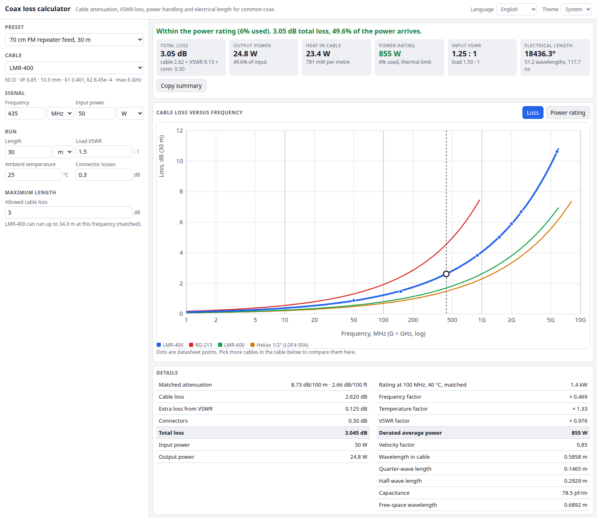

# Coax Loss Calculator

How much signal does your coax cable lose, and how much power can it take? Pick a cable (RG-58, RG-213, LMR-400, Aircell 7, Ecoflex, Heliax and more), a length and a frequency. You get the attenuation, the extra loss from a mismatched antenna, the output power, the heat in the cable, a derated power rating and the electrical length. Then compare every cable side by side.

**Try it: [hermes98761234.github.io/coax-loss-calculator](https://hermes98761234.github.io/coax-loss-calculator/)**

[](https://github.com/hermes98761234/coax-loss-calculator/actions/workflows/deploy.yml)



## Features

- **16 common cables** with a k1/k2 attenuation model, `A(f) = k1·√f + k2·f`, fitted to datasheet points. You can also enter your own k1, k2, velocity factor, impedance and power rating.
- **Loss versus frequency chart** from 1 MHz to 10 GHz, with datasheet points marked and any cables you tick drawn alongside.
- **Extra loss from VSWR**, input VSWR at the radio end, and connector losses.
- **Average power rating** derated for frequency, ambient temperature and load VSWR (standing-wave hot spot and peak voltage), shown as a chart and a factor breakdown.
- **Velocity factor and electrical length**: degrees, wavelengths, delay, quarter-wave and half-wave lengths, capacitance per metre.
- **Maximum length solver** for an allowed loss, and a **comparison table** of all cables at your frequency and length.
- **Presets** for HF, 2 m, 70 cm, Wi-Fi, ADS-B, GPS, LoRa and broadcast feeders.
- **Metres or feet, mW/W/kW/dBm, English or Ukrainian, light or dark theme.** Inputs are remembered in the browser. Nothing leaves your device.

## How it works

Each cable has a few datasheet attenuation points, in dB per 100 m at given frequencies. A least-squares fit of relative error gives the skin-effect term k1 and the dielectric term k2, both kept non-negative. The fit reproduces every stored point within 12 % (checked in the tests).

With a load of VSWR `s`, the reflection is `Γ = (s−1)/(s+1)`. For a line with matched power transmission `a²`, the extra loss is `(1 − Γ²a⁴) / (1 − Γ²)`. That is 0.5 dB for 1 dB of cable and a 3:1 load, the usual ARRL figure.

The power rating starts from the datasheet value at 100 MHz and 40 °C, matched. It scales with `A(100 MHz) / A(f)` (heat per metre), with the allowed temperature rise `(Tmax − Tamb) / (Tmax − 40)`, and is cut by the worst standing-wave hot spot and the peak voltage against the working voltage. It is expressed as net power into the cable.

## Limitations

Cable values are typical catalogue figures (Times Microwave, Belden, Messi & Paoloni, CommScope) and are approximate. Real cable differs by manufacturer, batch, bends, age and connectors. Power ratings are an engineering estimate, not a guarantee, so check the datasheet for critical work. Loss beyond a cable's specified frequency is extrapolated and flagged.

## Quick start

You need [Node.js](https://nodejs.org/) 22.

```bash
git clone https://github.com/hermes98761234/coax-loss-calculator.git
cd coax-loss-calculator
npm install
npm run dev       # http://localhost:5173
npm test          # cable model, VSWR loss, rating, i18n tests
npm run build     # static site in dist/
```

## License

MIT
